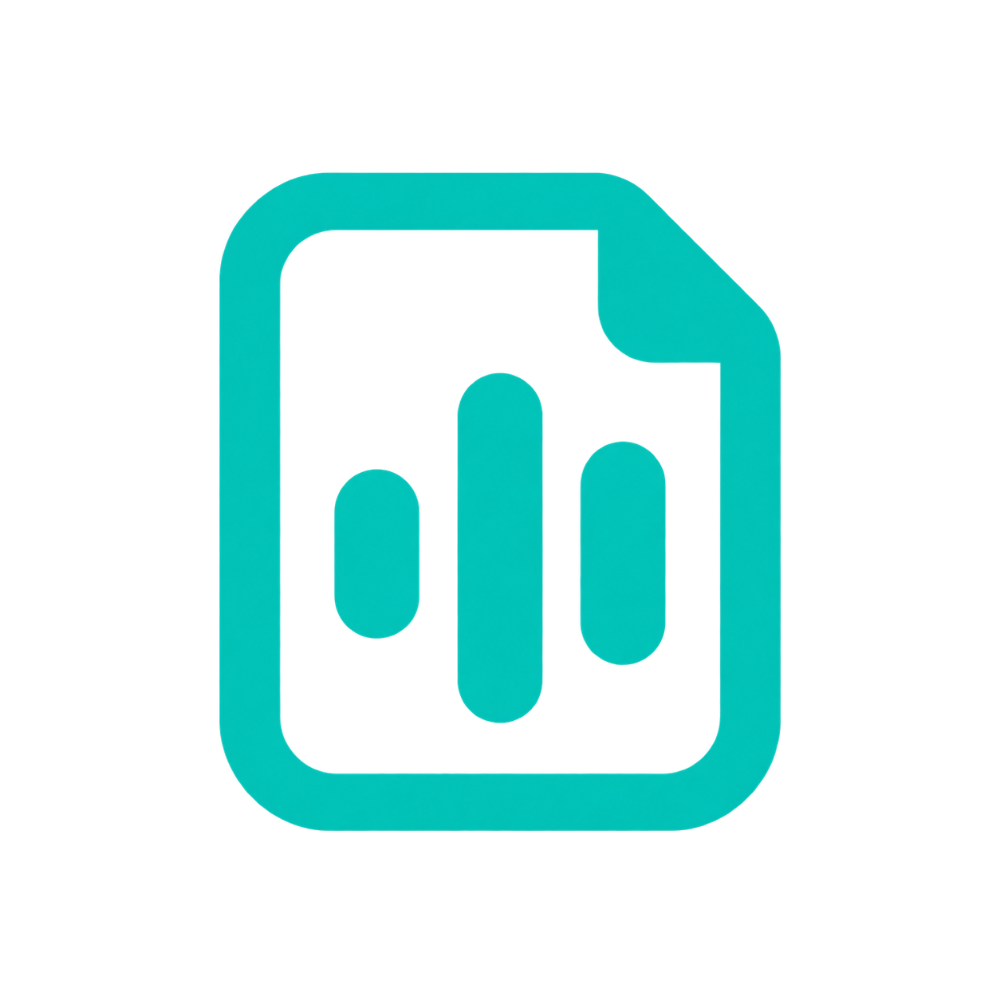

# 声笺



让表达，自然成文。macOS 本地语音转写与 AI 改写工具，独立于任何输入法。

- Apple 设备端语音识别或 Whisper.cpp 本地模型。
- 热词、改写规则与录音测试在同一页调整。
- 可选在线 Chat Completions 服务改写；只发送文字，不发送原始录音。
- 全局录音快捷键、后台波形、可选复制与自动填写。
- 本地音频及处理历史，支持重试和模型/耗时/用量记录。
- 音频输入设备启动检测与 Core Audio 变更订阅，防止双开。
- Breeze 本地语音合成：音色描述、参考音频克隆、使用转写原文或改写结果、播放与音频保存。
- 设置页检测独立 MLX 环境、模型完整性并提供安装与修复；支持系统代理和安装日志。

Breeze 首次安装需联网下载约 7 GB 模型；运行时仅监听本机并使用离线模型。模型及生成音频受研究与非商业许可限制。修复前需停止语音服务。

## 代码结构

| 目录 | 职责 |
| --- | --- |
| `Sources/App` | 应用入口、依赖装配、窗口导航和生命周期 |
| `Sources/Presentation` | 听写、历史、设置、权限引导的视图与页面状态；通用 UI 组件 |
| `Sources/Application` | 转写与整理流程、历史数据管理、共享配置、统一授权状态及活动互斥 |
| `Sources/Domain` | 配置、音频与处理记录等数据类型 |
| `Sources/Infrastructure` | 录音播放、Apple/Whisper、Breeze 服务与安装、模型 HTTP 客户端、持久化与 macOS 系统交互 |

页面依赖各自的 Model；Model 调用业务流程和具体服务。`AppModel` 负责创建和连接这些对象，不承载业务实现。核心流程和基础服务不依赖页面、悬浮窗或页面 Model。

录音、准备授权与后台处理通过 `ActivityState` 的单一阶段保留互斥关系；关闭悬浮条可取消自动输入，已开始的转写仍会保存到历史。窗口、定时器、快捷键和识别任务均由明确的所有者管理并在退出时清理。

当前保持单一应用编译目标，采用具体类型和必要的闭包注入，没有通用 Repository 基类、服务定位器或依赖注入框架。需要增加识别引擎时，在识别适配器与 `TranscriptionService` 中接入；模型请求统一经过 `ModelClient`。

## 构建

仅支持 Apple Silicon（M 系列芯片），要求 macOS 14+、Xcode Command Line Tools 和已有固定自签名证书的私钥。

```sh
./build.sh          # 默认 Release，仅 arm64
./build.sh Debug    # 本地调试
```

产物：`build/声笺.app`。脚本从源文件、`App/Info.plist` 和品牌资源创建全新 App，不依赖已有二进制。

可选环境变量：`APP_VERSION=1.0.0`、`BUILD_NUMBER=1`、`BUILD_DIR=/absolute/path`。
固定证书配置仅保存在本机 `~/.config/shengjian/signing`，私钥保存在系统钥匙串。可用 `SHENGJIAN_SIGNING_DIR` 指定配置目录，不允许 ad-hoc 签名或每次重建证书。

```sh
python3 -m unittest discover -s Tests -p 'test_*.py' -v
python3 Scripts/run_checks.py
python3 Tests/SigningChecks.py # 构建后执行
```

隔离检查先单独编译并测试 `Domain`、`Application` 和 `Infrastructure`，再运行页面状态与窗口检查，无需改写应用入口。测试使用模拟识别程序和本机 HTTP 服务，不读取用户录音、API Key 或系统授权。

### 首次授权回归

建议在独立 macOS 测试账户中验证，避免重置日常账户的权限：

1. 首次打开设置，麦克风和语音识别显示“未申请”。点击“申请授权”应先出现系统授权弹窗，不应直接进入空的系统权限列表；等待期间按钮不可重复点击。
2. 允许后状态变为“已授权”；拒绝后变为“已拒绝”，再次点击才打开对应系统权限页。下方“系统听写”是独立的键盘设置入口。
3. 保持辅助功能未授权，打开辅助功能引导，拖动系统设置窗口。引导卡片应随窗口移动；系统设置切页重建窗口后应能重新跟随，无需先授予辅助功能或录屏权限。
4. 最小化系统设置或切换到无关 App 时卡片应隐藏，恢复系统设置后重新出现；授权完成或退出系统设置后卡片应关闭。

`python3 Scripts/run_checks.py` 包含权限状态流转、重复请求、系统设置窗口替换和卡片坐标回归。系统授权弹窗与实际拖动跟随仍需上述人工验收。

## GitHub Actions

`.github/workflows/macos.yml` 包含两个独立节点：

1. **build**：main 推送或手动运行时，在 GitHub 托管 macOS ARM64 runner 执行检查、Release arm64 构建、验证签名，上传 ZIP、SHA256SUMS 与构建清单。
2. **release**：仅手动运行并勾选 `publish_release` 时运行，使用 build 的同一签名产物创建版本标签和 GitHub Release。

在 Actions → macOS Build and Release → Run workflow 中：

- 不勾选发布：仅构建，版本号可留空。
- 勾选发布：必须填写 `X.Y.Z`（允许 `vX.Y.Z`），例如 `1.0.0`；仅允许 main 分支发布。
- 重复版本会失败，不覆盖旧标签或旧 Release。

GitHub 的输入表单不支持“根据勾选动态必填”，因此版本约束由 build 的第一步强制校验。

### 签名托管

固定签名身份通过 GitHub Actions Secrets 托管：`SIGNING_CERTIFICATE_P12`、`SIGNING_CERTIFICATE_PASSWORD`、`SHENGJIAN_EXPECTED_SIGNING_IDENTITY`。
证书文件、私钥及密码不进入代码或 Git 历史。CI 导入临时钥匙串，结束后删除。
本机配置位于 `~/.config/shengjian/signing`，私钥保存在系统钥匙串。
更新 Secrets：`python3 Scripts/configure_signing_secrets.py CodeKillerCoser/shengjian`。

自签名产物没有 Apple 公证，首次安装可能需要用户在系统设置中允许打开。

## 应用身份与升级

Bundle ID：**`com.shengjian.app`**，可执行文件名 `Shengjian`。

此前本机原型使用 `local.rimevoice.desktop`，切换到正式 Bundle ID 需重新授权一次麦克风、语音识别和辅助功能。后续保持 Bundle ID、签名证书和安装位置一致。

应用数据统一保存于 `~/Library/Application Support/Shengjian`：设置位于 `settings.json`，录音与历史位于 `History/`，临时录音位于 `Temporary/`，Breeze 模型、独立 Python 环境与缓存位于 `Engines/Breeze/`。启动时可将旧 `RimeVoice` 数据目录整体迁移到尚不存在的新目录。钥匙串服务名保留兼容标识，以继续读取已有凭据。发布包不包含用户数据。
